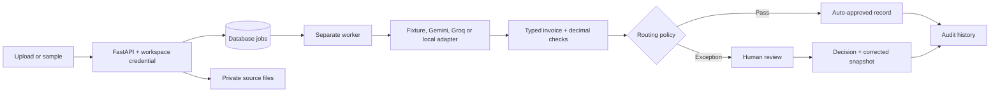

# Folio

**AI invoice processing with independent verification and human review.**

[Try Folio](https://yashmodi1804.github.io/folio-invoice-verification/launch/) ·
[Sample-only preview](https://yashmodi1804.github.io/folio-invoice-verification/) ·
[Architecture](#how-it-works) · [Run locally](#run-locally)

Folio is a full-stack proof of capability for agencies building document automation.
It turns invoice PDFs and images into structured records, checks the numbers in
Python, and sends uncertain or inconsistent results to a reviewer. The model
proposes data; it never decides whether its own extraction is correct. Every review
decision is recorded without overwriting the original extraction.

### Explore the demo

Open **[Try Folio](https://yashmodi1804.github.io/folio-invoice-verification/launch/)** to enter a private
guest workspace—no account or invitation needed. Start with the labeled synthetic
**HelixPoint** sample: an 18-line, two-page enterprise invoice whose printed total
is $125 too high. Folio loads its labeled fixture extraction, shows the arithmetic
discrepancy and source evidence, then routes the record to human review. You can also
upload a synthetic invoice to exercise live Groq extraction, subject to the demo's
usage limits. The branded entry page waits for the live workspace to be ready and
offers the sample walkthrough immediately. Share this link rather than the direct
Render address, which can show Render's wake-up screen after inactivity.

The **[GitHub Pages preview](https://yashmodi1804.github.io/folio-invoice-verification/)**
is a separate, sample-only walkthrough. It does not accept uploads or call an AI
provider. The live app runs on a free Render deployment, which may take time to wake
after inactivity; its free database has a fixed expiry. Neither surface should be
used for confidential customer documents.

### What this demonstrates

- **Bounded intake:** validates file content and size, renders multi-page documents,
  and persists asynchronous jobs with idempotency protection.
- **Traceable extraction:** validates provider output against typed schemas and shows
  page-level evidence, provider usage, and failure details.
- **Independent decisions:** verifies line items, subtotal, and total with `Decimal`;
  incomplete or inconsistent invoices go to human review instead of silently entering
  an approved dataset.
- **Auditable handoff:** preserves the original result, appends reviewer decisions,
  and exposes approved records through a versioned ERP-ready JSON contract.

**Stack:** Python, FastAPI, Pydantic v2, SQLAlchemy, Alembic, PostgreSQL, PyMuPDF,
React, TypeScript, Vite, and a database-backed worker. Groq, Gemini, and local
Ollama adapters are available; synthetic fixtures are explicitly labeled and make
no model calls.

## Run locally

Install Python 3.12+, Node 24, and pnpm 11.19.0, then:

```sh
python3 -m venv .venv
.venv/bin/python -m pip install -r requirements.lock
cp .env.example .env
pnpm --dir web install --frozen-lockfile
pnpm --dir web build
.venv/bin/python scripts/dev.py
```

The startup script applies migrations, starts the database-backed worker, and serves
the compiled console through FastAPI. SQLite and private local files make the demo
usable without Docker, cloud accounts, or a model key. Fonts ship with the frontend.
Open **http://127.0.0.1:8000** and use the local demo token `local-demo-only`.
Stop the API and worker together with Ctrl-C. VS Code users can instead run
**Terminal → Run Task → Folio: start demo** after setup.

## Four honest demonstrations

| Sample | Expected behavior |
| --- | --- |
| Clean invoice | Two pages, complete evidence, all arithmetic checks pass; automatic approval. |
| $50 discrepancy | Printed total is 1300.00, calculated total is 1250.00; human review. |
| Uncertain date | Arithmetic passes, fixture date confidence is 0.62; human review. |
| HelixPoint enterprise invoice | Two pages and 18 line items; subtotal passes, printed total is $125 too high; human review. |

These are explicitly labeled **synthetic fixtures**, including their confidence values.
They exercise real persistence, verification, routing, and review. They are not live
model results or an extraction-accuracy benchmark. Arbitrary uploads never receive
canned extraction data: in fixture mode they fail with `LIVE_PROVIDER_NOT_CONFIGURED`.

## Live extraction with your free-tier provider

The current rehearsal uses **Groq Qwen 3.8 27B**, with explicit local recovery on
availability errors. See [rehearsal notes](docs/REHEARSAL.md) for measured results,
recording instructions, and quota limitations. Run `.venv/bin/python scripts/preflight.py`
before recording; it makes no cloud inference call.

```dotenv
PROVIDER=groq
GROQ_API_KEY=your-key
GROQ_MODEL=qwen/qwen3.8-27b
LOCAL_FALLBACK_ENABLED=true
```

Groq uses image inputs and JSON mode, followed by strict local Pydantic validation.
This model accepts up to **three pages per request**; Folio rejects excess pages
before inference and shows the limit in the console. JSON mode alone does not
guarantee the extraction schema. Free-tier quotas still apply; do not submit a rapid
batch immediately before recording. See [Groq vision documentation](https://console.groq.com/docs/vision).

For real inference without an API quota, see [local Ollama setup](docs/LOCAL_INFERENCE.md).
Local mode keeps extraction on this machine and is clearly separate from offline fixtures.

The Gemini adapter is opt-in. Set these values in your untracked `.env` and restart:

```dotenv
PROVIDER=gemini
GEMINI_API_KEY=your-key
GEMINI_MODEL=your-currently-available-vision-model
```

Select a model supported by your account's free tier. Availability, quotas, and data
handling terms depend on the provider; Folio does not provision or enforce a free
billing tier. The adapter uses Google's
[generateContent API](https://ai.google.dev/api/generate-content) with image inputs,
a JSON schema, one cloud attempt per job, and local Pydantic validation. Its contract is tested
using mocked responses. Gemini `gemini-3.6-flash` was also checked with 11 local
evaluation inputs on 2026-09-16; see [live evaluation](docs/LIVE_EVALUATION.md).
The saved alternative is now `gemini-3.1-flash-lite` with
`GEMINI_THINKING_LEVEL=minimal`, tested on the challenge invoice on September 18.

Local fallback is opt-in and requires the Ollama server to be running. Upload audit
events pin consent. Only availability failures permit fallback; invalid extractions
or bad arithmetic do not. The UI shows the actual provider, and the failed cloud
attempt remains auditable. There is no silent cloud-to-cloud substitution.

Unknown live cost is `null`, never a fabricated zero. Fixture cost is explicitly zero
because there is no API call. Confidence is a model heuristic, not a calibrated
probability. Page citations are review aids, not independently verified provenance.

## How it works



- **Domain:** `app/domain` contains typed schemas, arithmetic, and pure routing policy.
- **Intake:** content sniffing, extension checks, file/page/pixel limits, private generated
  storage keys, and idempotency keys. Uploads return 202 with a persisted job ID.
- **Worker:** conditional database updates claim jobs. Terminal results are not replayed.
  Attempts interrupted for more than ten minutes fail visibly; retries after uncertain
  provider outcomes are not automatic. Exactly-once provider billing is not promised.
- **Verification:** line calculations, subtotal, and total use `Decimal` and explicit
  rounding. Missing amounts do not become zero. USD/EUR/GBP are supported in v1.
- **Review:** corrections and mandatory notes produce a separate decision snapshot.
  Switch between the reviewed record and original extraction; corrected fields are
  labeled **Reviewed**, and citations still refer to the original source. Human approval
  can explicitly accept remaining discrepancies; the checks stay visible. ERP exports
  use the effective reviewed checks and actual approval timestamp.
- **Telemetry:** recorded provider usage, processing latency, policy reasons, health
  endpoints, and JSON worker logs without source text.
- **ERP handoff:** approved records expose a versioned, vendor-neutral JSON export with an
  idempotency key. A connector maps that payload to NetSuite, Odoo, Dynamics, SAP, or a
  client API, then acknowledges its external record ID back into Folio's audit trail.

The relational model keeps immutable extraction/check JSON inside each job aggregate;
review decisions and audit events are separate related tables. This intentionally
simplifies the SRS's more normalized reference design for a small demo.

## API

Interactive documentation: **http://127.0.0.1:8000/docs**. Use its **Authorize** button
with the operator token. All `/api/v1` routes and source images require authentication.
The optional guest-session creation route is public; every document and review route
still requires a valid operator or guest credential and checks workspace ownership.

| Method | Endpoint | Purpose |
| --- | --- | --- |
| POST | `/api/v1/documents` | Multipart upload; requires `Idempotency-Key` header |
| POST | `/api/v1/samples/{clean\|variance\|uncertain\|helixpoint}` | Explicit synthetic fixture |
| POST | `/api/v1/guest-sessions` | Create a private guest workspace when enabled |
| GET | `/api/v1/jobs` | Latest 100 records and effective reviewed summaries |
| GET | `/api/v1/jobs/{id}` | Original extraction, checks, usage, and status |
| GET | `/api/v1/jobs/{id}/pages/{page}` | Authenticated source-page preview |
| GET | `/api/v1/review-tasks` | Pending review, failures first, oldest first |
| POST | `/api/v1/review-tasks/{id}/decision` | Approve/reject with note and optional corrected invoice |
| GET | `/api/v1/jobs/{id}/audit` | Original and review events |
| GET | `/api/v1/jobs/{id}/decision` | Corrected snapshot and recalculated checks |
| GET | `/api/v1/jobs/{id}/erp-export` | Versioned export for approved records only |
| POST | `/api/v1/jobs/{id}/erp-export/acknowledgements` | Persist a connector's external record ID |
| GET | `/api/v1/metrics` | Counts, review/failure rates, and processing latency percentiles |
| GET | `/health/live`, `/health/ready` | API liveness; database/storage/worker readiness |
| GET | `/health/launch` | Minimal readiness signal for the public entry page; no credentials |

## Development and verification

```sh
.venv/bin/python -m pytest -q
.venv/bin/ruff check .
.venv/bin/ruff format --check .
.venv/bin/python -m app.evaluate
pnpm --dir web test
pnpm --dir web build
```

For frontend hot reload, run `pnpm --dir web dev` alongside the API and worker.
Vite proxies API traffic to port 8000. VS Code tasks and extension recommendations
are included. CI runs the Python checks, migration, offline evaluation, frontend tests,
and production build.

Tests cover invalid documents, decimal tolerance, incomplete fields, false confidence,
review history, duplicate decisions, idempotency, provider schema failures, transient
errors, interrupted jobs, source retention, and redacted API errors.

## Deployment foundation

The [GitHub Pages preview](https://yashmodi1804.github.io/folio-invoice-verification/)
is a public, sample-only walkthrough. It uses four synthetic invoices exported by
`scripts/export_public_preview.py` from the same Python verifier and routing policy.
It makes no AI calls, accepts no private uploads, and keeps trial review decisions
only in the current browser tab. Its source pages and result JSON are public assets.
GitHub Pages cannot run the FastAPI API, database, or worker. Do not put an operator
token or provider key in the Pages build. To deploy live extraction, use a separate
backend host with private credentials and persistent document/database storage.

The [Render live-demo deployment guide](docs/RENDER.md) records the temporary
full-stack setup and its 30-day data limit. It uses private PostgreSQL source
storage and an embedded worker because free Render web services have no persistent
filesystem or free background-worker plan.

Set `GUEST_ENABLED=true` only when public trials are intended. A guest link creates
a persistent browser credential and preloads four labeled fixtures, including the
18-line HelixPoint invoice. The operator workspace and historical records stay
separate. Guest uploads are limited to two per guest and 20 across the site in a
rolling day, three pages and 5 MB per file, with at most ten guest jobs pending.
Guest access and samples have no application expiry. Each personal upload, its result,
review decisions and audit events become inaccessible after two hours and are deleted
when the embedded worker runs cleanup; free-service sleep means physical deletion is
not guaranteed at the exact expiry minute. Clearing browser storage loses the anonymous
credential. The free Render database itself has a fixed expiry, so it cannot promise
permanent storage for any workspace.
New workspaces are bounded to 60 per hour, 250 per day, and 2,000 total by default;
returning guests remain usable after new-workspace capacity is reached. These limits
bound fixture/storage growth as well as live inference usage. HTTP requests also have
streamed body limits; quota decisions serialize concurrent guest admissions.
These bounds are a demo safeguard, not a promise of provider availability or
production-grade account security.

To rebuild the public assets locally, run `.venv/bin/python -m scripts.export_public_preview`
then `FOLIO_PUBLIC_PREVIEW=1 VITE_FOLIO_PUBLIC_PREVIEW=true pnpm --dir web build`.
The Pages workflow performs both steps on `main` and publishes only `web/dist`.

`compose.yaml` provides PostgreSQL, migration, API, and worker services with shared
private source storage. Set a strong `OPERATOR_TOKEN` and `POSTGRES_PASSWORD` in `.env`,
then run `docker compose up --build`. Ports bind to localhost by default. Docker was
not available on the development machine, so this path is supplied but not executed.

For a client deployment, add the client's identity/tenant isolation, managed storage,
TLS, rate limiting, monitoring, backups, and provider data-processing agreement.
The local demo token is public and unsuitable for a shared environment. Native PDF/image
inspection, rendering and text planning run in short-lived child processes, with one
parser at a time per application process, a 15-second wall timeout, 10-second CPU limit,
and bounded output. Linux enforces a 256 MiB address-space ceiling; macOS does not enforce
that memory ceiling. Busy requests are retryable; a busy worker requeues before inference.
This limits resource use but is not an operating-system security sandbox or a load benchmark.

Before proprietary redistribution, review dependency licensing and choose a project
license. In particular, [PyMuPDF is offered under AGPL or a commercial license](https://pymupdf.readthedocs.io/en/latest/about.html).
This repository does not currently grant a project-wide license; public source access
does not itself establish unrestricted white-label reuse rights.

Source retention defaults to seven days. Preview expiration without deleting anything:

```sh
.venv/bin/python -m app.retention
```

`--apply` permanently deletes expired source files and records an audit event. It does
not delete extraction/review records; define a separate client data-erasure policy.
The long-running worker checks for expired sources hourly; the command remains
available for a manual dry run or immediate cleanup.

## Sales handoff

See [the live document pack and Loom plan](docs/DEMO_PACK.md),
[the continuous 60-second live demo](docs/LOOM_60S_LIVE.md),
[the offline demo script](docs/DEMO.md), [verification report](docs/ACCEPTANCE.md),
[SRS](SRS.md), and [build plan](BUILD_PLAN.md).
Current priorities and release gates are in the [product review](docs/PRODUCT_REVIEW.md).
